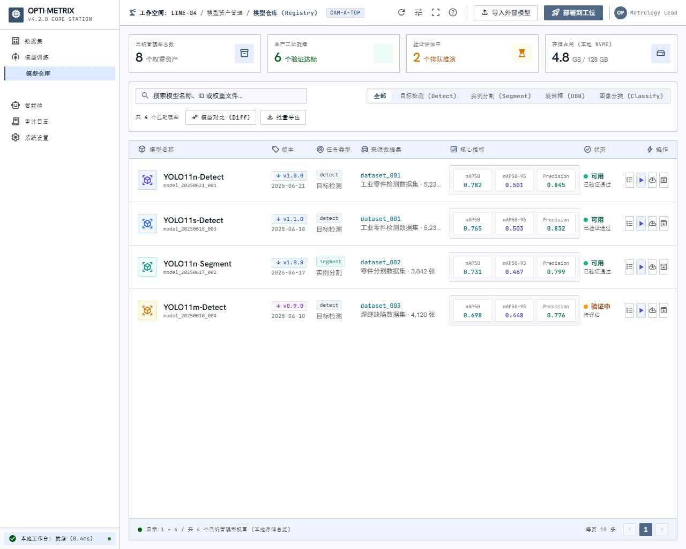
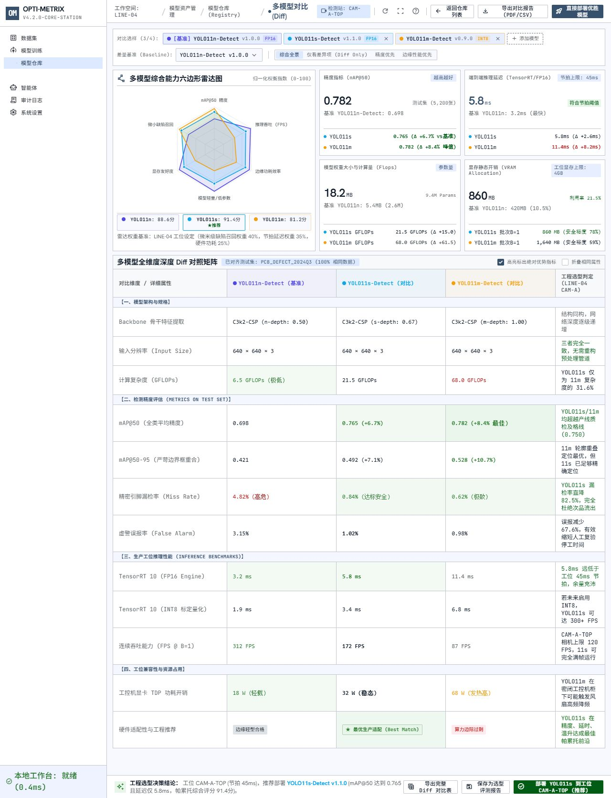
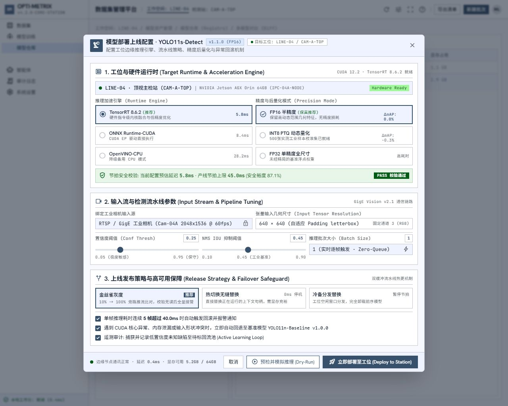
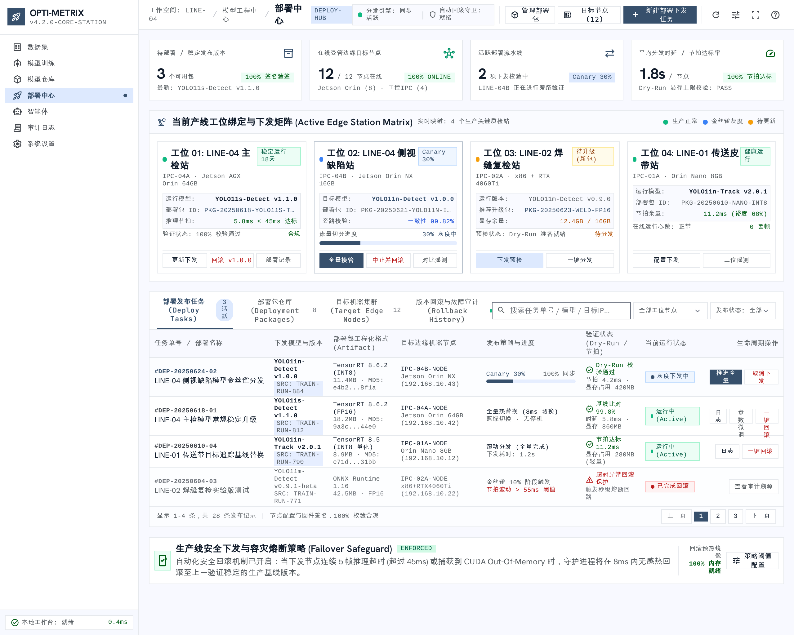

# Stitch 原始参考页面

项目：检测系统工作台首页；项目 ID：18239273122054167103。

按用户指定的四个 screen ID 获取。托管 download URL 是需要认证的 Stitch API 地址；使用 Stitch download_file 下载了原始图片与 HTML，未以未认证 curl 结果代替文件。

这些文件是产品设计参考，不是已实现业务，不是测试证据。HTML 保留原始示例文本、示例指标及外部 CDN/字体/图片引用，不可直接并入生产。图片已经逐张审阅，未执行 HTML 中的外部脚本。本轮未改写原始设计稿；所需调整见上级任务规划文档。

## 模型仓库 - 检测系统工作台

Screen ID：ee909f86d97341bc8f8ca2fade81ed4b

[原始 HTML](01-model-registry.html) · [原始图片](01-model-registry.jpg)

## 模型仓库 - 多模型对比 (Diff) 综合看板

Screen ID：8048d65cb86c4da8b03f0101b61b1e98

[原始 HTML](02-model-comparison.html) · [原始图片](02-model-comparison.jpg)

## 模型仓库 - 部署上线配置弹窗画板

Screen ID：64832da5e0784caeacf89710329205ff

[原始 HTML](03-deploy-dialog.html) · [原始图片](03-deploy-dialog.jpg)

## 部署中心 - 模型下发与分发管理工作台

Screen ID：e2c183d00c98445da078ff80eb959562

[原始 HTML](04-deployment-center.html) · [原始图片](04-deployment-center.png)

